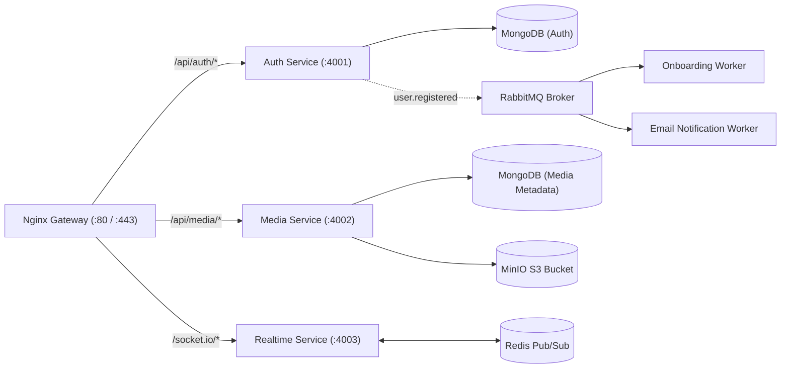

# VibeGrid Services — Distributed Microservices & Worker Pool

> **High-performance microservices and event-driven worker pool powering authentication, object storage presigning, real-time WebSockets, and asynchronous event processing for VibeGrid.**

[](https://www.typescriptlang.org/)
[](https://pnpm.io/)
[]()
[](https://www.rabbitmq.com/)
[](https://www.mongodb.com/)
[](https://min.io/)

---

## 🏛️ Microservices Cluster Architecture



---

## 📦 Workspace Packages & Services

| Package / Service | Port | Description | Primary Dependencies |
| :--- | :---: | :--- | :--- |
| **`@vibegrid/auth-service`** | `4001` | Asymmetric RS256 JWT, refresh token families, OAuth 2.0 (Google/GitHub), RBAC | Express, Mongoose, Jose, Bcrypt |
| **`@vibegrid/media-service`** | `4002` | MinIO presigned URL issuance, quota enforcement, image metadata tracking | AWS S3 SDK, Express, Mongoose |
| **`@vibegrid/realtime-service`** | `4003` | Socket.IO server with Redis adapter for distributed presence & instant messaging | Socket.IO, Redis, JSON Web Token |
| **`@vibegrid/onboarding-worker`** | Worker | RabbitMQ consumer processing asynchronous user profile initialization | amqplib, Pino |
| **`@vibegrid/email-worker`** | Worker | Transactional notification email delivery via AMQP worker queues | amqplib, Nodemailer |
| **`@vibegrid/contracts`** | Library | Shared TypeScript interfaces and JSON Schema event definitions | Zod, TypeScript |
| **`@vibegrid/logger`** | Library | Standardized Pino JSON logging with daily file rotation & correlation IDs | Pino, Pino-Roll |

---

## 🧪 Monorepo Test Scorecard

```text
Scope: 7 of 8 workspace projects
Test Suites: 28 passed, 28 total
Tests:       158 passed, 158 total (114 in Auth Service)
Snapshots:   0 total
Status:      100% PASS (Zero Failures, Zero Skipped)
```

Targeted suites verify:
- **Asymmetric Token Cryptography:** RS256 key loading, token verification, token revocation families.
- **OAuth & User Provisioning:** Google/GitHub profile linking and idempotent account creation.
- **Presigned URL Lifecycle:** S3 command builders, valid expiry headers, MIME-type whitelists.
- **WebSocket PubSub:** Multi-instance Redis adapter room synchronization and presence tracking.

---

## 🚀 Quick Start & Development

### Prerequisites
- Node.js 20+
- pnpm 9.15+
- Docker & Docker Compose

### 1. Installation
```bash
git clone https://github.com/manakhly/VibeGrid_Services.git
cd VibeGrid_Services
pnpm install
```

### 2. Configure Environment
Copy `.env.example` to `.env`:
```bash
cp .env.example .env
```

### 3. Launch Supporting Infrastructure
```bash
docker compose -f infrastructure/docker-compose.yml up -d
```

### 4. Run Microservices
```bash
# Start all microservices in parallel
pnpm dev:all

# Or run individual services
pnpm dev:auth
pnpm dev:media
pnpm dev:realtime
```

### 5. Run Verification & Tests
```bash
# Typecheck across all workspace packages
pnpm -r typecheck

# Run all test suites
pnpm -r test
```

---

## 🛡️ Database Maintenance & Cleaners

The services include automated maintenance scripts:

```bash
# Clean authentication & media MongoDB collections
pnpm clean:mongo:all

# Specific cleaner options
node services/auth/scripts/clean_mongo.js --include-admins
node services/media/scripts/clean_media_mongo.js
```

---

## 📄 License
This project is licensed under the MIT License — see the [LICENSE](LICENSE) file for details.

